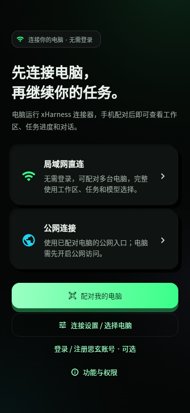
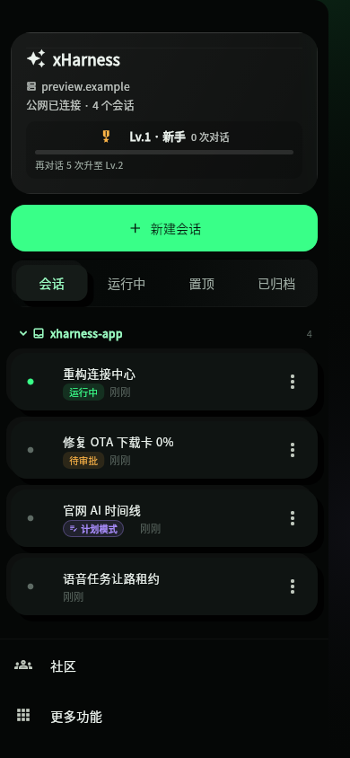
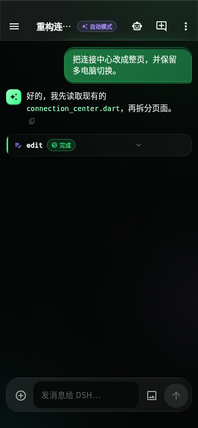
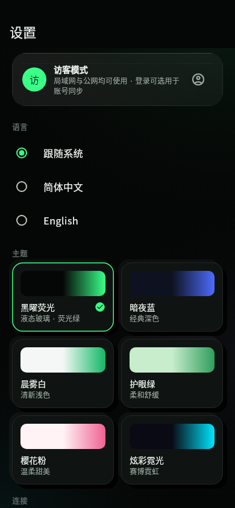

# xHarness

**把电脑上的 AI 编程智能体装进口袋。**

xHarness 是 DeepSeek Harness（DSH） 的 Flutter 手机客户端。通过 DSH 的 HTTP + WebSocket 接口连接你自己的电脑，在手机上发起任务、看流式输出、处理审批与提问、切换模型——代码和模型始终在你的电脑上运行。

[](https://dsh.sixuanai.com/releases-public/dsh-app-latest.apk)
[](LICENSE)
[](https://flutter.dev)

<p align="center">
  
  
  
  
</p>

<p align="center"><sub>2.7.0「黑曜荧光」界面：纯黑底 · 液态玻璃 · 新拟态 · 荧光绿（界面预览使用合成数据）</sub></p>

## 下载

| 平台 | 获取方式 |
| --- | --- |
| Android（arm64） | [下载最新 APK](https://dsh.sixuanai.com/releases-public/dsh-app-latest.apk) · [版本信息](https://dsh.sixuanai.com/releases-public/version.json) |
| 已安装用户 | App 内「检查更新」，自动下载并校验 SHA-256 后覆盖安装 |
| iOS | 工程已就绪，尚未上架，见 [iOS 准备](#ios--app-store) |

当前版本 **2.7.0**（arm64 versionCode 2149）。下载由 Cloudflare R2 分发，发布流程见 [Cloudflare 下载与维护](docs/releases/CLOUDFLARE_DOWNLOADS.md)。

## 功能

**连接与账号**

- **无需登录即可使用**：局域网、已配对电脑的公网入口、多电脑切换、工作区、任务与模型选择全部开放；思玄账号仅用于注册与同步，是可选项。
- **安全配对**：电脑生成 2 分钟有效、一次性的二维码；手机获得独立设备密钥并固定电脑 HTTPS 证书；电脑可逐台撤销设备。
- **多电脑**：保存多台配对电脑，在连接中心一键切换；局域网优先，断线自动回退到公网入口并重连。
- **操作权限由电脑决定**：命令执行、文件修改遵循电脑端 DSH 的授权与确认规则，登录不会自动获得更高权限。

**会话与任务**

- 会话按工作区（目录）分组、可折叠；新建会话可选择工作区，对话中新建自动继承。
- 对话视图：历史分页、Markdown（代码块 / 引用 / 表格）、思考过程折叠、流式输出。
- 工具调用卡片，编辑 / 写入类调用以 diff 呈现。
- 审批（允许一次 / 拒绝）与 ask-user 提问（单选 / 多选 / 自定义文本）。
- 运行统计：轮次、耗时、首 token、tok/s、缓存命中、上下文占用。
- 模型目录与推理强度切换；会话模式（goal / plan / auto）标识。
- 本地 SQLite 缓存，冷启动秒开，弱网先显示后刷新。

**体验**

- **黑曜荧光主题**（默认）：荧光绿主色，青 / 紫 / 琥珀 / 珊瑚作为信息、Agent、审批、错误的语义色；另有晨雾白浅色主题及多款经典主题。设计规范见 [docs/design/obsidian-neon](docs/design/obsidian-neon/DESIGN.md)。
- **大肥鱼互动宠物**：上下文累计 1M token 对应一碗白米饭，自动成长与手动互动；素材来源与许可见 [资源说明](docs/pet/DAFEIYU.md)。
- **宠物排行榜**：思玄账号参与总榜与本周成长榜，支持公开昵称和退出排行，访客可查看。[规则与自建部署](docs/pet/LEADERBOARD.md)。
- 社区动态、好友码、等级排行与私聊。
- 应用内更新（Android）、内置更新日志、中英文界面。

## 连接自己的电脑

1. 在电脑上安装并启动 DSH，保持其原生服务只监听回环地址。
2. 在本仓库根目录运行连接器安装脚本，然后从应用菜单打开 **xHarness 电脑连接器**：

   ```bash
   bash server/connector/install.sh --name '我的电脑'
   ```

3. 手机与电脑在同一网络下，电脑生成二维码，App 中点 **连接我的电脑**，拍摄或导入二维码，核对电脑名称与证书指纹后确认。
4. （可选）配置公网入口后，离开局域网也能继续使用，App 无需登录。

当前电脑端安装器支持 **Linux + systemd 用户会话**，依赖 Python 3.10+（含 venv）、Node.js 20+、OpenSSL 与已安装的 DSH；Windows / macOS 安装器尚未提供。

- [连接器安装、使用、维护与卸载](docs/connector/README.md)
- [实现与验收记录](docs/connector/IMPLEMENTATION.md)
- [历史手工部署方式](docs/connector/LEGACY-CONNECTIONS.md)

## 安全与隐私

- 设备密钥存放在系统安全存储，电脑只保存加盐散列；Android 禁止应用数据备份。
- 配对凭据与思玄账号会话相互隔离，设备凭据不会发送给账号、社区或管理服务。
- 局域网与公网均使用固定证书的 HTTPS / WSS；连接器通过独立认证桥访问本机 DSH，DSH 原始授权 Cookie 不会下发到手机。
- 手机丢失时请在电脑端撤销对应设备——手机上「忘记电脑」只删除本地信息。

## 从源码构建

```bash
flutter pub get
flutter analyze && flutter test
flutter build apk --debug
adb install -r build/app/outputs/flutter-apk/app-debug.apk
```

正式包使用 `flutter build apk --release --split-per-abi --target-platform android-arm64`。分 ABI 构建会给 versionCode 加偏移（arm64 为 +2000），发布脚本会从 APK 中读取真实值写入清单。签名文件（`android/key.properties`、`*.jks`）与发布配置（`server/release-cdn.json`）不在仓库中，自行发布时请使用你自己的签名与配置。

## 发布（维护者）

```bash
# 1. 修改 pubspec.yaml 的 version，并在 lib/src/changelog.dart 顶部添加更新日志
# 2. 构建并发布（自动复用最新产物）
tool/publish.sh            # 或 --rebuild / --no-build / --dry-run
```

发布器会校验 APK 版本与覆盖升级签名，上传 R2 并从公网完整下载回验 SHA-256，最后才更新 `latest.json` / `version.json` 与下载跳转；任一步失败都不会切换版本。详见 [Cloudflare 下载与维护](docs/releases/CLOUDFLARE_DOWNLOADS.md) 与 [运维说明](server/OPERATIONS.md)。

## 自建服务

本仓库包含客户端、电脑连接器及可选服务端组件；作者的托管实例（`dsh.sixuanai.com`、`accounts.sixuanai.com` 等）仅供作者自用，可能随时变化。自建时可参考：

| 组件 | 位置 | 说明 |
| --- | --- | --- |
| 电脑连接器 / 公网网关 | `server/connector/` | 配对、设备管理、公网转发 |
| 社区服务 | `server/social-server.py` | 好友、动态、私聊（Python 标准库 + SQLite） |
| 账号目录与注册 | `server/registration/` | 旧版账号目录与邮箱注册 |
| 认证代理 / nginx 样例 | `server/dsh-auth-proxy.js`、`server/*.sample` | 旧版部署方式 |

App 的邮箱账号服务地址在 `lib/src/sixuan_account.dart`，更新清单地址为 `lib/main.dart` 中的 `kUpdateManifestUrl`。

## 项目结构

```
lib/
  main.dart                应用入口、页面导航、连接切换
  state.dart               AppState：连接生命周期、事件折叠、路由选择
  connection_center.dart   连接中心与多电脑管理
  connector_pairing_page.dart 二维码配对
  src/protocol.dart        DSH Web 线协议（一元 RPC、WS 下行流、审批 / 提问应答）
  src/connector_*.dart     配对数据、固定证书传输
  src/theme.dart           主题与语义色板
  src/ui/                  液态玻璃、新拟态等通用组件
  src/localstore.dart      SQLite 本地缓存
  src/updater.dart         应用内更新
server/                    连接器、社区、注册与运维样例
tool/                      发布、冒烟测试、素材处理脚本
docs/                      设计、连接器、发布与宠物素材文档
```

## iOS / App Store

iOS 工程已预配置（`NSAllowsLocalNetworking`、`ITSAppUsesNonExemptEncryption = false`）。应用内更新只在 Android 编译，iOS 通过 TestFlight / App Store 分发。在 Mac 上安装 Xcode、CocoaPods 与 Flutter 后：

```bash
flutter pub get
open ios/Runner.xcworkspace   # Signing & Capabilities 中选择你的 Team
flutter build ipa
```

提交审核时请提供演示账号，并保证审核期间 DSH 电脑在线。

## 应用市场素材

<p align="center">
  
</p>

封面与 Google Play 特性图位于 `assets/store/`（`hermes-agent-cover-01~03.png`、`hermes-agent-google-play-feature.png`）。

## 鸿蒙版本

鸿蒙适配为独立代码快照，见 [harmonyos/HARMONYOS.md](harmonyos/HARMONYOS.md)，与主项目不自动同步。

## 参与贡献

欢迎提交 issue 与 PR。修改协议层前请运行 `dart run tool/smoke.dart` 与 `flutter test`；界面改动请遵循 [黑曜荧光设计规范](docs/design/obsidian-neon/DESIGN.md)，颜色一律从主题色板读取。

## 许可

代码以 [MIT License](LICENSE) 开源，可自由使用、修改、商用与再分发，只需保留版权声明。第三方动画资源另附 [资源许可](assets/pet/dafeiyu/LICENSE.txt) 与 [来源记录](assets/pet/dafeiyu/provenance.json)。许可证不涵盖作者的托管实例、域名与部署环境。
